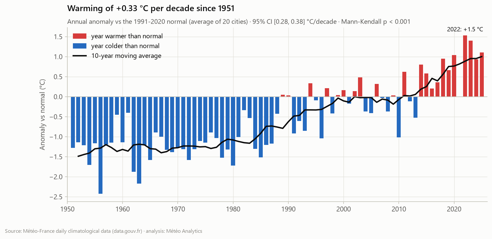
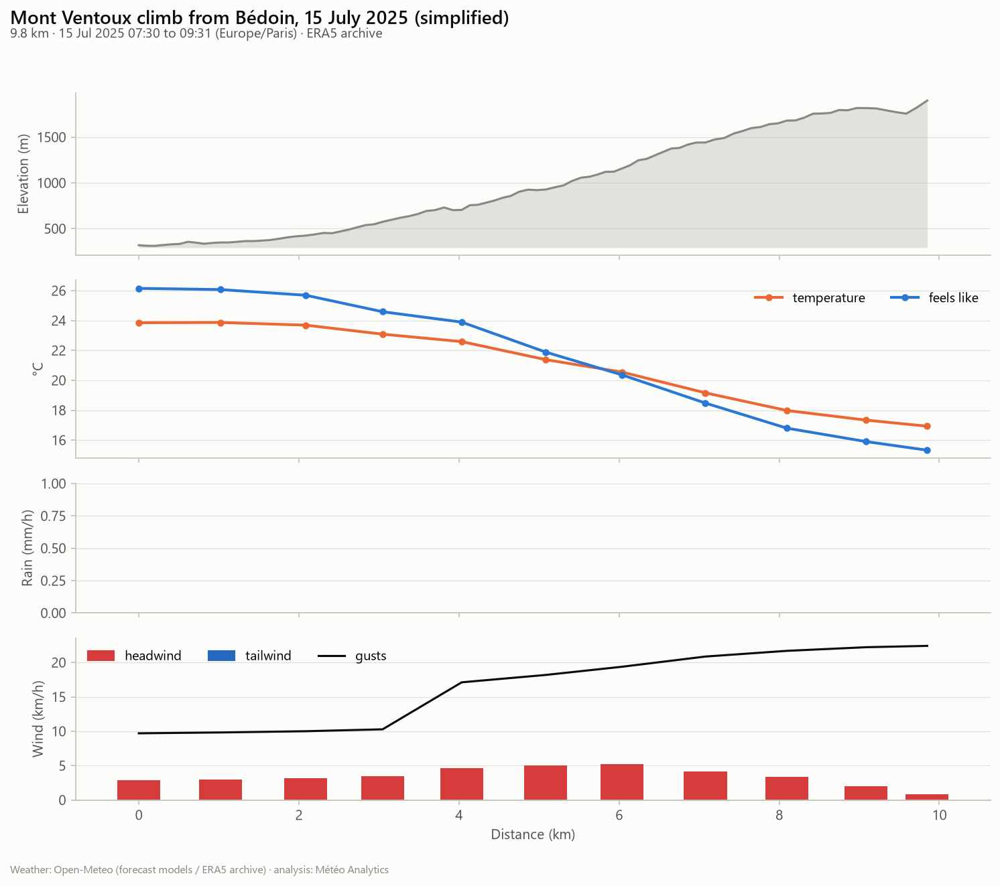

# Météo Analytics: 75 years of climate in 20 French cities

[](https://github.com/ElliotGalaor/MeteoReading/actions/workflows/ci.yml)
[](https://github.com/ElliotGalaor/MeteoReading/actions/workflows/cd.yml)

End-to-end data pipeline that **collects 25 million official weather records**, cleans them, stores them in an
analytical warehouse, draws statistically sound conclusions and presents them in an **interactive dashboard**
and an **HTML report**. It also gives a **weather reading along any GPS track**: draw a route on the map, import a GPX/KML/GeoJSON
file or pick a sample, and see the conditions at the time you pass each point.

**Try it online: [meteoreading-fqwbevysja-ew.a.run.app](https://meteoreading-fqwbevysja-ew.a.run.app)**
(Google Cloud Run; after a quiet period, the first page takes a few seconds to start).

> Business question: *how much have large French cities warmed since 1951, and what does it change in practice
> (extreme heat, frost, rainfall)?*



## Key results

| Finding | Figure | Confidence |
|---|---|---|
| Average warming of the 20 cities since 1951 | **+0.33 °C per decade** (95% CI: 0.28 to 0.38) | Mann-Kendall p < 0.001, significant in all 20 cities |
| Since 1981, the pace is speeding up | **+0.43 °C per decade** | p < 0.001 |
| 2011-2025 compared with 1961-1990 | **+1.75 °C** | the 10 warmest years all came after 2010 |
| Season warming the fastest | **summer** (+0.43 °C per decade, vs ~0.30 for the other seasons) | p < 0.001 |
| Days at 35 °C or more | **× 5.5** (0.7 → 3.9 per year and per city) | |
| Tropical nights (TN ≥ 20 °C) | **× 3.1** | |
| Frost days | **−34%** | |
| Heat records for each cold record | **15 to 1** since 2020 (1 to 1 in the 1960s) | |
| Annual rainfall | **no trend** (−0.4% per decade) | p = 0.59: not significant |
| All-time record measured | **43.5 °C in Montpellier** on 28 June 2019 | |

The full report, with every figure and the method, is in [reports/climate_report.html](reports/climate_report.html)
(a single file to open in a browser). For a presentation: [docs/interview_guide.md](docs/interview_guide.md)
(pitch, 5-minute demo, likely questions).

## What the project demonstrates

| Skill | Where to see it |
|---|---|
| **Bulk data collection**: 40 files (268 MB) discovered through the data.gouv.fr API, downloaded in parallel, with retries and a traceability manifest | [meteo/download.py](meteo/download.py) |
| **Quota-aware API client**: computes the cost of each call, rate limiter, cache | [meteo/era5.py](meteo/era5.py) |
| **Analytical SQL**: CTEs, window functions, `QUALIFY`, `PIVOT`, macros, "gaps and islands" | [sql/](sql/) and [sql/example_queries.sql](sql/example_queries.sql) |
| **Data quality**: quality codes, physical bounds, consistency, duplicates, completeness, series splicing | [sql/02_quality.sql](sql/02_quality.sql), [sql/03_stations.sql](sql/03_stations.sql) |
| **Statistics**: anomalies, regression with CI, Mann-Kendall, Theil-Sen, records (Meehl 2009), z-scores | [meteo/stats.py](meteo/stats.py) |
| **Exploratory machine learning**: PCA + k-means, choice of k by silhouette | [meteo/analysis.py](meteo/analysis.py) |
| **Cross-validation** against an independent source (ERA5 reanalysis) | [meteo/era5.py](meteo/era5.py) |
| **Data visualisation**: colour-blind-safe palette, one idea per chart | [reports/figures/](reports/figures/) |
| **Dashboard**: 7 interactive pages, including a SQL editor | [dashboard/](dashboard/) |
| **Geospatial data**: GPX/KML/GeoJSON parsing (safe XML), routing on OpenStreetMap, resampling, elevation, bearings, time interpolation, head/tail wind | [meteo/gps.py](meteo/gps.py), [meteo/routing.py](meteo/routing.py), [meteo/route_weather.py](meteo/route_weather.py) |
| **Software quality**: externalised configuration, automated tests, `ruff` lint, pipeline reproducible in one command | [tests/](tests/), [config.yaml](config.yaml) |
| **DevOps**: GitHub Actions CI (lint, tests on 3 Python versions, **Docker** image with its data built once, smoke-tested and published to GHCR, weekly data refresh) and CD (that same image promoted on **Google Cloud Run**: staging, then production after approval, keyless authentication through Workload Identity Federation) | [.github/workflows/](.github/workflows/), [Dockerfile](Dockerfile), [docs/DEPLOY.md](docs/DEPLOY.md) |

## Quick start

**Windows (PowerShell)**, from the project folder:

```powershell
py -m venv .venv                                         # "py": the official Windows Python launcher
.venv\Scripts\python.exe -m pip install -r requirements.txt
.venv\Scripts\python.exe -m meteo all                    # collection + warehouse + ERA5 + analyses + report (~3 min)
.venv\Scripts\python.exe -m streamlit run dashboard/app.py   # dashboard on http://localhost:8501
```

**macOS / Linux**:

```bash
python3 -m venv .venv && source .venv/bin/activate
pip install -r requirements.txt
python -m meteo all
streamlit run dashboard/app.py
```

<details>
<summary>Windows troubleshooting</summary>

- **`.venv\Scripts\activate` not found**: the environment was created by another Python (MSYS2, Cygwin…) that
  stores its files in `bin\`. Delete `.venv` and create it again with `py -m venv .venv`.
- **"running scripts is disabled on this system"** when activating the environment: there is no need to activate
  it, prefix the commands with `.venv\Scripts\python.exe` as above. To be able to activate it
  (`.venv\Scripts\Activate.ps1`), allow local scripts once: `Set-ExecutionPolicy -Scope CurrentUser RemoteSigned`.
- **"An Application Control policy has blocked this file"** on the first import: Windows Smart App Control checks
  the reputation of new DLLs; running the command again usually works.

</details>

Each step can also be run on its own (environment activated, or replacing `python` with `.venv\Scripts\python.exe`):

```bash
python -m meteo download     # 1. collection (~30 s)
python -m meteo build        # 2. DuckDB warehouse (~13 s for 25 M rows)
python -m meteo era5         # 3. ERA5 cross-validation (~2 min, limited by the API quota)
python -m meteo analyze      # 4. statistics and figures (~6 s)
python -m meteo report       # 5. HTML report
python -m meteo query sql/example_queries.sql   # annotated SQL queries
python -m meteo route samples/paris_versailles_bike.gpx --start "2026-11-20 09:00" --activity cycling
python -m pytest             # tests
```

## Deployment

The dashboard runs on **Google Cloud Run**, deployed by GitHub Actions:

| Environment | URL | Deployed |
|---|---|---|
| Production | [meteoreading-fqwbevysja-ew.a.run.app](https://meteoreading-fqwbevysja-ew.a.run.app) | after approval |
| Staging | [meteoreading-staging-fqwbevysja-ew.a.run.app](https://meteoreading-staging-fqwbevysja-ew.a.run.app) | automatically, after each merge to `main` |

- **continuous integration** on every pull request and push: `ruff` and `actionlint`, tests on Python 3.12, 3.13
  and 3.14, then a Docker image built **with its data** (the pipeline runs during the build) and smoke-tested:
  health endpoint, ~25 million rows in the warehouse, dashboard rendered headless;
- **continuous delivery**: every push to `main` publishes the tested image to GitHub Container Registry, then deploys
  that same image, never rebuilt, to a staging service and, after approval, to production on Cloud Run;
- **weekly data refresh**: every Monday the image is rebuilt with the latest Météo-France observations and
  deployed the same way.

Set-up (one script in Cloud Shell, a few GitHub variables), costs and limits: [deployment guide](docs/DEPLOY.md).
Run the same image locally:

```bash
docker run -p 8080:8080 ghcr.io/elliotgalaor/meteoreading:latest
```

## The dashboard

| Page | Content |
|---|---|
| **Overview** | key indicators, warming stripes, map of the cities, main takeaways |
| **Explore a city** | up to 3 cities, 13 indicators, by season, as values or anomalies, with a tested trend |
| **A year in detail** | every day of a year compared with the normal (mean and 10th-90th percentiles) |
| **Extremes and records** | city × decade heatmap, then vs now, records, filterable heat episodes |
| **Data and quality** | pipeline diagram, quality summary, station network, series splicing, ERA5 validation, limitations |
| **SQL queries** | live SQL editor on the warehouse (read-only, disk access blocked), CSV export |
| **Route weather** | weather along a route drawn on the map, uploaded or picked from the samples: map, profile, point-by-point reading, nearby station observations |

## Route weather reading

Three ways to get a track:

- **draw it on the map**: search a place, click your waypoints, finish the line. The route can **follow roads and
  paths** suited to walking, cycling or driving (OSRM routing engine on OpenStreetMap data), or join your points
  with straight lines (off-trail). The altitude of every point is added (Open-Meteo elevation API), and the route
  can be saved as GPX;
- **import a file** exported from Strava, Garmin, Komoot or Google Earth (GPX, KML or GeoJSON);
- **pick a [sample track](samples/)**.

Then the tool:

1. **reads the track** safely (`defusedxml`), drops repeated points, computes distances, ascent and the direction of travel;
2. **times each point**: the recorded timestamps for a past activity, or an estimate for a planned trip
   (departure time + speed, with extra time for climbs when walking or cycling);
3. **samples up to 40 points** at least 1 km apart and fetches the hourly weather for all of them in one batch:
   the **Open-Meteo forecast API** for the last 3 months and the next 16 days (best models for the area, e.g.
   Météo-France AROME/ARPEGE over France), the **ERA5 archive** for older trips;
4. **interpolates the weather at the exact time** you pass each point (wind as a vector), adjusts temperatures to
   the altitude, and splits the wind into **headwind / tailwind / crosswind** along your heading;
5. **writes the reading**: where and when it rains, temperature range (coldest point), wind against you, strong
   gusts, thunderstorm or ice risk, plus the observations of the **Météo-France stations within 5 km** of the route
   for past trips (ground truth from the warehouse).



*Example from the command line (`--png`): the Mont Ventoux sample recorded on 15 July 2025, read from the ERA5 archive. The temperature drops by 7 °C between Bédoin and the summit, with a light headwind and no rain.*

## Architecture

```
data.gouv.fr (API)          Open-Meteo (ERA5 API)
       │                            │
       ▼                            ▼
 download.py ──► data/raw/  (bronze: 40 CSV.gz + manifest.json, immutable)
                     │
                     ▼  DuckDB, logic written in SQL (sql/01 → 04)
       stg_daily     25 M typed rows, quality codes kept
       obs_flags     status of each measurement (valid, missing, suspect, out of range, inconsistent)
       obs_daily     "clean" view (validated values only)
       ref_station   reference station(s) per city + station_offsets (series splicing)
       city_daily / city_monthly / city_yearly / city_heatwaves / city_dry_spells   (gold)
                     │
          ┌──────────┼───────────────┬──────────────────┐
          ▼          ▼               ▼                  ▼
     analysis.py   report.py   dashboard/app.py   data/gold/*.parquet
     (stats, figures)  (HTML)    (Streamlit)       (Power BI, Tableau…)
```

## Data

- **Source**: Météo-France, [Données climatologiques de base quotidiennes](https://www.data.gouv.fr/fr/datasets/donnees-climatologiques-de-base-quotidiennes/) (daily climatological data), Etalab 2.0 open licence.
- **Volume** (November 2026 snapshot): 25,027,470 rows, 2,433 stations, 20 départements (French administrative areas), from 1 January 1950 to November 2026.
- **Variables**: minimum and maximum temperature (TN, TX), mean of hourly temperatures (TM), rainfall (RR), mean wind and gusts, each with its quality code.
- **Validation**: ERA5 (Copernicus) through the free [Open-Meteo](https://open-meteo.com/) API, 2015-2024.
- **Route weather**: Open-Meteo forecast, archive, elevation and geocoding APIs; map tiles and routing from
  [OpenStreetMap](https://www.openstreetmap.org/copyright) contributors (routing servers hosted by FOSSGIS, for light use).

To analyse the whole of France (overseas territories included), set `extra_departments: all` in [config.yaml](config.yaml): about 1.3 GB and more than 100 million rows, without changing the code.

## Methodology and deliberate choices

- **Mean temperature = (TN + TX) / 2**, the climatological convention: the hourly mean (TM) only exists since stations were automated and would create a break in the series.
- **One reference station per city**, chosen automatically in SQL: the most complete over 1951-2025, within 40 km of the centre and within 200 m of its altitude (otherwise Grenoble ended up with a mountain station at 806 m).
- **Series splicing** when a station closes or has gaps (Reims, Grenoble, Limoges): the backup station is corrected for the bias measured **month by month** on the shared days (from −2.8 to −1.2 °C depending on the season for Limoges, hence a monthly correction).
- **Valid month** if at least 90% of its days have data, **valid year** if at least 95%; result: 20 cities × 75 complete years.
- **National average = average of the anomalies**, not of raw temperatures: the indicator does not move when a city is missing a year.
- **A trend is only called significant when both the linear regression AND the Mann-Kendall test are** (5% level).
- **2026 is excluded from the statistics** (incomplete year) but remains visible in the dashboard.

## Data quality: what the analysis revealed

- Météo-France already validates its data: **204 values rejected out of 58.9 million** measurements present, no duplicates.
- **The real issue is completeness**: 55% of the rows have no temperature (most stations only measure rainfall), and the network keeps changing (1,100 active rain stations in 1995, 500 today).
- **ERA5 tracks day-to-day weather very well** (0.987 correlation on TX) **but smooths out local effects**: +4.7 °C on Ajaccio's nights (the grid cell includes the sea), −1.6 °C in Paris (the urban heat island does not exist in the reanalysis), and in Ajaccio 90 days ≥ 30 °C instead of the 456 observed. For local extremes, stations remain essential.

## Limitations and next steps

- Non-homogenised series (changes of instruments, urbanisation around stations): only identified relocations are corrected.
- Statistical tests assume independent years: the p-values are slightly optimistic (next step: Hamed and Rao's modified Mann-Kendall test).
- Next steps: extend to the whole of France, add sunshine and humidity (the "autres paramètres" files), the official Météo-France heatwave indicator, schedule a daily refresh (cron or GitHub Actions), deploy the dashboard on Streamlit Community Cloud.

## Structure

```
MeteoReading/
├── .github/               # CI and CD workflows, Cloud Run deploy action
├── Dockerfile             # image: dependencies, data built at build time, dashboard
├── deploy/gcp-setup.sh    # one-time Google Cloud setup (Cloud Shell)
├── config.yaml            # cities, periods, thresholds, paths: all the settings
├── meteo/                 # Python package
│   ├── __main__.py        # command-line interface
│   ├── download.py        # bulk collection
│   ├── warehouse.py       # DuckDB warehouse orchestration
│   ├── stats.py           # pure statistical functions (tested)
│   ├── analysis.py        # one function per business question
│   ├── era5.py            # Open-Meteo cross-validation
│   ├── gps.py             # GPS tracks: parsing, distances, sampling, timing
│   ├── routing.py         # track from map clicks: routing, resampling, elevation
│   ├── route_weather.py   # weather reading along a track
│   ├── viz.py, palette.py # static charts
│   └── report.py, fmt.py  # HTML report
├── sql/                   # transformations (01 → 04) and example queries
├── dashboard/             # Streamlit app
├── samples/               # sample GPS tracks (simplified routes)
├── templates/             # report template
├── tests/                 # pytest, including an end-to-end test on synthetic data
└── reports/               # report, figures, CSV tables, results.json
```
