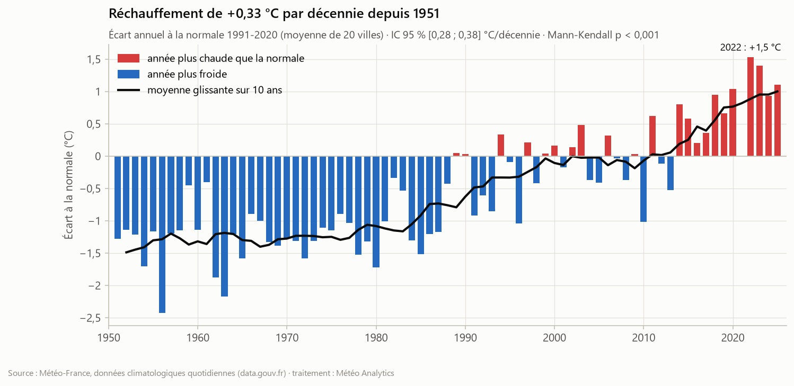

# Météo Analytics : 75 ans de climat dans 20 villes françaises

Pipeline de données de bout en bout qui **collecte 25 millions de relevés météo officiels**, les nettoie, les stocke
dans un entrepôt analytique, en tire des conclusions statistiquement solides et les restitue dans un
**dashboard interactif** et un **rapport HTML**.

> Question métier : *de combien les grandes villes françaises se sont-elles réchauffées depuis 1951, et qu'est-ce
> que cela change concrètement (chaleur extrême, gel, pluie) ?*



## Résultats clés

| Constat | Chiffre | Fiabilité |
|---|---|---|
| Réchauffement moyen des 20 villes depuis 1951 | **+0,33 °C par décennie** (IC 95 % : 0,28 à 0,38) | Mann-Kendall p < 0,001, significatif dans les 20 villes |
| Depuis 1981, le rythme accélère | **+0,43 °C par décennie** | p < 0,001 |
| 2011-2025 comparé à 1961-1990 | **+1,75 °C** | les 10 années les plus chaudes sont toutes après 2010 |
| Saison qui se réchauffe le plus vite | **l'été** (+0,43 °C par décennie, contre ~0,30 pour les autres saisons) | p < 0,001 |
| Journées à 35 °C ou plus | **× 5,5** (0,7 → 3,9 par an et par ville) | |
| Nuits tropicales (TN ≥ 20 °C) | **× 3,1** | |
| Jours de gel | **−34 %** | |
| Records de chaleur pour un record de froid | **15 pour 1** depuis 2020 (1 pour 1 dans les années 1960) | |
| Cumul de pluie annuel | **pas de tendance** (−0,4 % par décennie) | p = 0,59 : non significatif |
| Record absolu mesuré | **43,5 °C à Montpellier** le 28/06/2019 | |

Le rapport complet, avec toutes les figures et la méthode, est dans [reports/rapport_climat.html](reports/rapport_climat.html)
(un seul fichier, à ouvrir dans un navigateur). Pour la soutenance : [docs/presentation_entretien.md](docs/presentation_entretien.md) (pitch, démo en 5 minutes, questions probables).

## Ce que le projet montre

| Compétence | Où la voir |
|---|---|
| **Collecte de données en masse** : 40 fichiers (268 Mo) découverts via l'API data.gouv.fr, téléchargés en parallèle, avec reprise sur erreur et manifeste de traçabilité | [meteo/download.py](meteo/download.py) |
| **Client d'API respectueux des quotas** : calcul du coût de chaque appel, limiteur de débit, cache | [meteo/era5.py](meteo/era5.py) |
| **SQL analytique** : CTE, fonctions de fenêtre, `QUALIFY`, `PIVOT`, macros, problème « gaps and islands » | [sql/](sql/) et [sql/analyses_exemples.sql](sql/analyses_exemples.sql) |
| **Qualité des données** : codes qualité, bornes physiques, cohérence, doublons, complétude, raccordement de séries | [sql/02_quality.sql](sql/02_quality.sql), [sql/03_stations.sql](sql/03_stations.sql) |
| **Statistiques** : anomalies, régression avec IC, Mann-Kendall, Theil-Sen, records (Meehl 2009), scores z | [meteo/stats.py](meteo/stats.py) |
| **Machine learning exploratoire** : ACP + k-means, choix de k par silhouette | [meteo/analysis.py](meteo/analysis.py) |
| **Validation croisée** avec une source indépendante (réanalyse ERA5) | [meteo/era5.py](meteo/era5.py) |
| **Data visualisation** : palette lisible par les daltoniens, une idée par graphique | [reports/figures/](reports/figures/) |
| **Dashboard** interactif en 6 pages, dont un éditeur SQL | [dashboard/](dashboard/) |
| **Qualité logicielle** : configuration externalisée, tests automatisés, pipeline reproductible en une commande | [tests/](tests/), [config.yaml](config.yaml) |

## Démarrage rapide

**Windows (PowerShell)**, depuis le dossier du projet :

```powershell
py -m venv .venv                                         # « py » : le lanceur Python officiel de Windows
.venv\Scripts\python.exe -m pip install -r requirements.txt
.venv\Scripts\python.exe -m meteo all                    # collecte + entrepôt + ERA5 + analyses + rapport (~3 min)
.venv\Scripts\python.exe -m streamlit run dashboard/app.py   # dashboard sur http://localhost:8501
```

**macOS / Linux** :

```bash
python3 -m venv .venv && source .venv/bin/activate
pip install -r requirements.txt
python -m meteo all
streamlit run dashboard/app.py
```

<details>
<summary>Dépannage Windows</summary>

- **`.venv\Scripts\activate` introuvable** : l'environnement a été créé par un autre Python (MSYS2, Cygwin…) qui
  range ses fichiers dans `bin\`. Supprimer `.venv` et le recréer avec `py -m venv .venv`.
- **« l'exécution de scripts est désactivée »** en activant l'environnement : inutile de l'activer, préfixer les
  commandes par `.venv\Scripts\python.exe` comme ci-dessus. Pour pouvoir activer (`.venv\Scripts\Activate.ps1`),
  autoriser une fois les scripts locaux : `Set-ExecutionPolicy -Scope CurrentUser RemoteSigned`.
- **« Une stratégie de contrôle d'application a bloqué ce fichier »** au premier import : le Contrôle intelligent
  des applications de Windows vérifie la réputation des nouvelles DLL ; relancer la commande suffit en général.

</details>

Chaque étape peut aussi se lancer seule (environnement activé, ou en remplaçant `python` par `.venv\Scripts\python.exe`) :

```bash
python -m meteo download     # 1. collecte (~30 s)
python -m meteo build        # 2. entrepôt DuckDB (~13 s pour 25 M lignes)
python -m meteo era5         # 3. validation croisée ERA5 (~2 min, limitée par le quota de l'API)
python -m meteo analyze      # 4. statistiques et figures (~6 s)
python -m meteo report       # 5. rapport HTML
python -m meteo query sql/analyses_exemples.sql   # requêtes SQL commentées
python -m pytest             # tests
```

## Le dashboard

| Page | Contenu |
|---|---|
| **Vue d'ensemble** | indicateurs clés, bandes de réchauffement, carte des villes, constats principaux |
| **Explorer une ville** | jusqu'à 3 villes, 13 indicateurs, par saison, en valeurs ou en écart à la normale, tendance testée |
| **Une année en détail** | chaque jour d'une année comparé à la normale (moyenne et 10e-90e centiles) |
| **Extrêmes et records** | carte de chaleur ville × décennie, avant/après, records, épisodes de chaleur filtrables |
| **Données et qualité** | schéma du pipeline, bilan qualité, réseau de stations, raccordements, validation ERA5, limites |
| **Requêtes SQL** | éditeur SQL en direct sur l'entrepôt (lecture seule, accès disque bloqué), export CSV |

## Architecture

```
data.gouv.fr (API)          Open-Meteo (API ERA5)
       │                            │
       ▼                            ▼
 download.py ──► data/raw/  (bronze : 40 CSV.gz + manifest.json, immuables)
                     │
                     ▼  DuckDB, logique en SQL (sql/01 → 04)
       stg_daily     25 M lignes typées, codes qualité conservés
       obs_flags     statut de chaque mesure (valide, absente, douteuse, hors bornes, incohérente)
       obs_daily     vue « propre » (valeurs validées uniquement)
       ref_station   station(s) de référence par ville + station_offsets (raccordement)
       city_daily / city_monthly / city_yearly / city_heatwaves / city_dry_spells   (gold)
                     │
          ┌──────────┼───────────────┬──────────────────┐
          ▼          ▼               ▼                  ▼
     analysis.py   report.py   dashboard/app.py   data/gold/*.parquet
     (stats, figures)  (HTML)    (Streamlit)       (Power BI, Tableau…)
```

## Données

- **Source** : Météo-France, [Données climatologiques de base quotidiennes](https://www.data.gouv.fr/fr/datasets/donnees-climatologiques-de-base-quotidiennes/), licence Etalab 2.0.
- **Volume** : 25 026 059 lignes, 2 433 stations, 20 départements, du 01/01/1950 au 09/11/2026.
- **Variables** : températures minimale et maximale (TN, TX), moyenne horaire (TM), pluie (RR), vent moyen et rafales, chacune avec son code qualité.
- **Validation** : ERA5 (Copernicus) via l'API gratuite [Open-Meteo](https://open-meteo.com/), 2015-2024.

Pour analyser toute la France (outre-mer compris), mettre `extra_departments: all` dans [config.yaml](config.yaml) : environ 1,3 Go et plus de 100 millions de lignes, sans modifier le code.

## Méthodologie et choix assumés

- **Température moyenne = (TN + TX) / 2**, convention climatologique : la moyenne horaire (TM) n'existe que depuis l'automatisation des stations et créerait une rupture.
- **Une station de référence par ville**, choisie automatiquement en SQL : la plus complète sur 1951-2025, à moins de 40 km du centre et à moins de 200 m d'écart d'altitude (sinon Grenoble se retrouvait avec une station de montagne à 806 m).
- **Raccordement de séries** quand une station ferme ou a des trous (Reims, Grenoble, Limoges) : la station de relais est corrigée du biais mesuré **mois par mois** sur les jours communs (de −2,8 à −1,2 °C selon la saison pour Limoges, d'où l'intérêt d'une correction mensuelle).
- **Mois valide** si au moins 90 % des jours sont mesurés, **année valide** si au moins 95 % ; résultat : 20 villes × 75 années complètes.
- **Moyenne nationale = moyenne des anomalies**, pas des températures brutes : l'indicateur ne bouge pas si une ville manque une année.
- **Une tendance n'est déclarée significative que si la régression linéaire ET le test de Mann-Kendall le sont** (seuil de 5 %).
- **2026 est exclue des statistiques** (année incomplète) mais reste visible dans le dashboard.

## Qualité des données : ce que l'analyse a révélé

- Météo-France valide déjà ses données : **208 valeurs rejetées sur 58,9 millions** de mesures présentes, aucun doublon.
- **Le vrai problème est la complétude** : 55 % des lignes n'ont pas de température (la majorité des postes ne mesurent que la pluie), et le réseau change (1 100 stations de pluie actives en 1995, 500 aujourd'hui).
- **ERA5 suit très bien la météo du jour** (corrélation 0,987 sur les TX) **mais lisse les effets locaux** : +4,7 °C sur les nuits d'Ajaccio (la maille inclut la mer), −1,6 °C à Paris (l'îlot de chaleur urbain n'existe pas dans la réanalyse), et à Ajaccio 90 journées ≥ 30 °C au lieu de 456 observées. Pour les extrêmes locaux, les stations restent indispensables.

## Limites et pistes

- Séries non homogénéisées (changements d'instruments, urbanisation autour des stations) : seuls les déménagements identifiés sont corrigés.
- Tests statistiques sous hypothèse d'indépendance des années : p-values un peu optimistes (piste : Mann-Kendall modifié de Hamed et Rao).
- Pistes : étendre à toute la France, ajouter l'ensoleillement et l'humidité (fichiers « autres paramètres »), indicateur canicule officiel Météo-France, planifier la mise à jour quotidienne (cron ou GitHub Actions), déployer le dashboard sur Streamlit Community Cloud.

## Structure

```
MeteoReading/
├── config.yaml            # villes, périodes, seuils, chemins : tout le paramétrage
├── meteo/                 # package Python
│   ├── __main__.py        # interface en ligne de commande
│   ├── download.py        # collecte massive
│   ├── warehouse.py       # orchestration de l'entrepôt DuckDB
│   ├── stats.py           # fonctions statistiques pures (testées)
│   ├── analysis.py        # une fonction par question métier
│   ├── era5.py            # validation croisée Open-Meteo
│   ├── viz.py, palette.py # graphiques statiques
│   └── report.py, fmt.py  # rapport HTML
├── sql/                   # transformations (01 → 04) et requêtes d'exemple
├── dashboard/             # application Streamlit
├── templates/             # gabarit du rapport
├── tests/                 # pytest, dont un test de bout en bout sur données synthétiques
└── reports/               # rapport, figures, tables CSV, resultats.json
```
