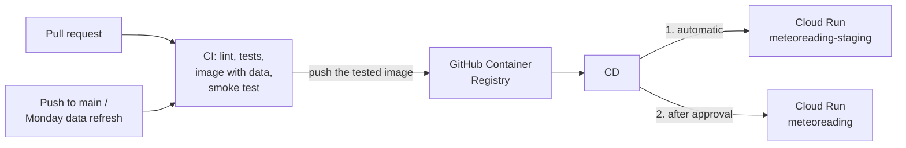
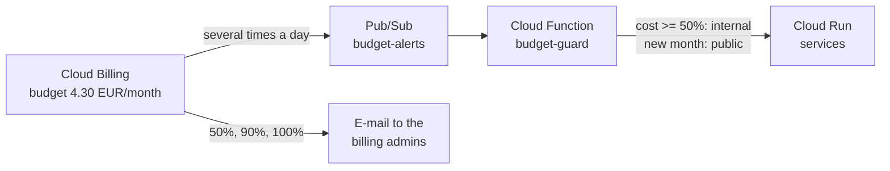

# Deploying on Google Cloud Run

The dashboard runs on [Cloud Run](https://cloud.google.com/run), Google's serverless container platform:
HTTPS out of the box, scales to zero between visits. GitHub Actions builds and tests the image, then promotes
that same image to a staging service and, after approval, to production.



## What is in the image

The image holds the dashboard **and its data**: during the build, the pipeline downloads the Météo-France files,
builds the DuckDB warehouse (~25 million rows), the figures and the results, and only the warehouse and the
results are kept in the final image (~300 MB of data). The container needs nothing else to start, and the
same image runs anywhere:

```bash
docker run -p 8080:8080 ghcr.io/elliotgalaor/meteoreading:latest
```

Inside, [Caddy](https://caddyserver.com) listens on port 8080 in front of Streamlit (which only listens on
127.0.0.1:8501), see [docker/Caddyfile](../docker/Caddyfile):

- it **compresses** the responses: a first visit downloads about 2.7 MB instead of 7.7 MB (Streamlit sends its
  JavaScript uncompressed, and Cloud Run does not compress either);
- it adds the **security headers** Streamlit does not send (HSTS, `nosniff`, framing limited to the site itself,
  referrer and permissions policies);
- it answers `robots.txt` (staging asks not to be indexed) and hides Streamlit's internal metrics;
- it serves the page shown when an idle tab pauses itself (see Costs).

[docker/start.sh](../docker/start.sh) starts both processes, and stops the container if either stops.

The data is downloaded again at most once a day (the CI passes the date as `DATA_VERSION`), and **every Monday**
a scheduled CI run rebuilds the image with the latest observations; CD then deploys it like any other image.

## Costs

For a portfolio with occasional visitors, this stays within Google Cloud's free tier:

- **Cloud Run** (tier 1 regions such as `europe-west1`): a monthly free allowance of CPU time, memory time and
  requests (about 50 hours of an instance). The services scale to zero between visits; a visit starts an
  instance in about 10 seconds (cold start).
  **A visit lasts as long as the tab stays open**: Streamlit keeps a WebSocket open, and Cloud Run bills the
  instance while a request is open. So a tab without any click, key or scroll for 20 minutes disconnects and shows
  a "paused" page, one click away from the same page ([dashboard/idle.py](../dashboard/idle.py),
  `IDLE_PAUSE_MINUTES` in the Dockerfile); a forgotten tab no longer keeps an instance running.
- **Artifact Registry**: 0.5 GB of free storage, then about 0.10 USD per GB and per month. The repository keeps
  only the 3 most recent images, and they share most of their layers.

A billing account is still required by Google, and **a Google Cloud budget only sends alerts: it never stops
anything**. The cost is capped at **5 USD per month** in three ways:

1. **A single instance at most** per service: the worst hour costs about 0.10 USD per service, never more.
2. **A monthly budget** of 4.30 EUR (the billing account is in euros: about 5 USD), with e-mail alerts at
   50%, 90% and 100%.
3. **A kill switch**, the `budget-guard` Cloud Function ([deploy/budget_guard](../deploy/budget_guard/main.py)).
   Cloud Billing posts the state of the budget to a Pub/Sub topic several times a day; when the cost of the month
   reaches **half the budget**, the function sets the ingress of both services to *internal*: they no longer
   answer on the Internet, start no instance and cost nothing more. When the next month starts, the cost
   restarts from zero and the function opens them again. Deploys go on in the meantime, and the CD summary says
   that the service is closed.



Why close at half the budget: billing data can be several hours late, so the kill switch sees the cost of the
morning in the afternoon. The other half absorbs what is spent in the meantime: one instance running non-stop
costs about 2.5 USD a day. The function only reopens the services it closed itself (label
`budget-guard=closed`), and it runs as a `budget-guard` service account that may change those two services and
nothing else.

Set it up once the services exist (after the first deploy), in Cloud Shell:

```bash
bash MeteoReading/deploy/gcp-budget.sh <PROJECT_ID> 4.30 europe-west1
```

The script ([deploy/gcp-budget.sh](../deploy/gcp-budget.sh)) can be run again, for instance with another amount
(in the currency of the billing account). It ends by printing how to test the kill switch on staging only.

## 1. Prepare Google Cloud (once)

You need a Google Cloud project with billing enabled. Then open **[Cloud Shell](https://shell.cloud.google.com)**
(the terminal icon at the top of the console: `gcloud` is installed and signed in) and run:

```bash
git clone https://github.com/ElliotGalaor/MeteoReading.git
bash MeteoReading/deploy/gcp-setup.sh <PROJECT_ID> europe-west1
```

The script ([deploy/gcp-setup.sh](../deploy/gcp-setup.sh)) can be run again safely. It creates:

| Resource | Purpose |
|---|---|
| Artifact Registry repository `meteoreading` | Cloud Run pulls images from Google's registry: CD copies the tested image there (same digest) |
| Service account `github-deployer` | What GitHub Actions acts as: deploys Cloud Run services, pushes to that repository, nothing else |
| Service account `meteoreading-run` | What the app runs as: no role at all, the app only calls public APIs |
| Workload Identity pool `github` + provider `github-oidc` | Lets GitHub Actions, for **this repository only**, exchange its OIDC token for short-lived Google credentials: **no service account key** to create, store or rotate |

It ends by printing the GitHub variables to set.

## 2. Configure GitHub (once)

1. **Repository variables** (**Settings** → **Secrets and variables** → **Actions** → **Variables**), from the
   output of the script: `GCP_PROJECT_ID`, `GCP_REGION`, `GCP_ARTIFACT_REPOSITORY`,
   `GCP_WORKLOAD_IDENTITY_PROVIDER`, `GCP_DEPLOY_SERVICE_ACCOUNT`, `GCP_RUNTIME_SERVICE_ACCOUNT`. These are
   identifiers, not secrets: thanks to Workload Identity Federation, nothing secret is stored on GitHub.
2. **`staging` environment**: **Settings** → **Environments** → **New environment**, name `staging`.
3. **`production` environment**: the same, name `production`, then:
   - **Required reviewers**: tick it, add yourself, **Save protection rules** (leave **Prevent self-review**
     unticked if you are the only reviewer);
   - **Deployment branches and tags**: **Selected branches and tags**, add `main`.

The Cloud Run services are created by the first deploy: `meteoreading-staging` and `meteoreading`. To use other
names, add a `CLOUD_RUN_SERVICE` variable to an environment.

Without `GCP_PROJECT_ID`, the deploy jobs do nothing and their log says so (forks, before the setup).

## 3. Automatic updates

**The image is built once, then promoted from one environment to the next**:

1. **CI** (`.github/workflows/ci.yml`), on every pull request, every push to `main` and every Monday: `ruff`
   and `actionlint`, the tests on Python 3.12, 3.13 and 3.14, then the Docker image is built with fresh data and
   smoke-tested (health endpoint, row count of the warehouse, the dashboard rendered headless with Streamlit
   `AppTest`). Except for pull requests, that exact image is pushed to GitHub Container Registry, tagged
   `run-<CI run id>`, `sha-<commit>` (pushes) and `latest`.
2. **CD** (`.github/workflows/cd.yml`), after every successful CI run on `main`: resolves the image to its digest,
   copies it to Artifact Registry, deploys it to **staging**, checks that the service answers, then waits for a
   reviewer and deploys the same digest to **production**.

| GitHub environment | Cloud Run service | Deployed |
|---|---|---|
| `staging` | `meteoreading-staging` | automatically, after each successful CI run on `main` |
| `production` | `meteoreading` | after approval, with the image staging received |

The deploy itself lives in a reusable composite action:
[.github/actions/deploy-cloud-run](../.github/actions/deploy-cloud-run/action.yml). The services are public, scale
from 0 to 1 instance (2 GiB, 1 vCPU, CPU boost at start-up, up to 20 visitors at a time), and use session affinity
with a long timeout, because Streamlit keeps one WebSocket open per visitor.

### Approve a production deploy

After staging, the run shows **Review deployments** and GitHub notifies the reviewers. Open the staging URL (in the
summary of the staging job), then tick `production` → **Approve and deploy**. When a newer image arrives while one
is waiting, the older one is cancelled: only the newest image waits for approval.

### Redeploy or roll back

**Actions** → **CD** → **Run workflow**, with the tag of any published image (`sha-<commit>`, `run-<id>`,
`latest` or a version): it goes through the same steps, staging then production after approval. The tags are listed
on the [package page](https://github.com/ElliotGalaor/MeteoReading/pkgs/container/meteoreading).

## Limits

- **Cold start**: after a while without visits, the first page takes about 10 seconds to load (the container
  starts, then the page downloads about 2.7 MB).
- **Idle tabs pause** after 20 minutes without interaction (see Costs): one click on "Resume" brings the page back.
- **Monthly budget**: if half the budget is spent, the site answers with an error 404 until the next month.
- **One instance**: up to 20 visitors at a time; beyond that, new visitors get an error until one leaves.
- **Route weather** calls the free Open-Meteo and OpenStreetMap routing services from the server: fine for a
  portfolio, not for heavy traffic (their fair-use limits apply to the server's address).
- The data is a snapshot taken at build time, refreshed every Monday.

## Troubleshooting

- **The deploy jobs say "GCP_PROJECT_ID variable not set"**: the repository variables are missing (step 2).
- **`google-github-actions/auth` fails with "permission denied" or "unable to acquire impersonated credentials"**:
  `GCP_WORKLOAD_IDENTITY_PROVIDER` or `GCP_DEPLOY_SERVICE_ACCOUNT` is wrong, or the repository name given to the
  setup script is not this repository: run the script again with the right name.
- **"Permission 'artifactregistry.repositories.uploadArtifacts' denied"**: the region of `GCP_REGION` is not the
  one of the repository created by the script.
- **"Deploy to production" stays "Waiting"**: it waits for a reviewer, see
  [Approve a production deploy](#approve-a-production-deploy).
- **The service answers but a page shows an error**: **Cloud Run** → the service → **Logs** in the Google Cloud
  console.
- **The site answers with an error 404 and the CD summary says "closed to the Internet"**: the budget guard closed
  it. Check the cost (**Billing** → **Reports**) and the log of the function
  (`gcloud functions logs read budget-guard --region europe-west1`). It reopens by itself next month; to reopen it
  now, raise the budget (`bash deploy/gcp-budget.sh <PROJECT_ID> <AMOUNT>`): the next notification reopens it.
